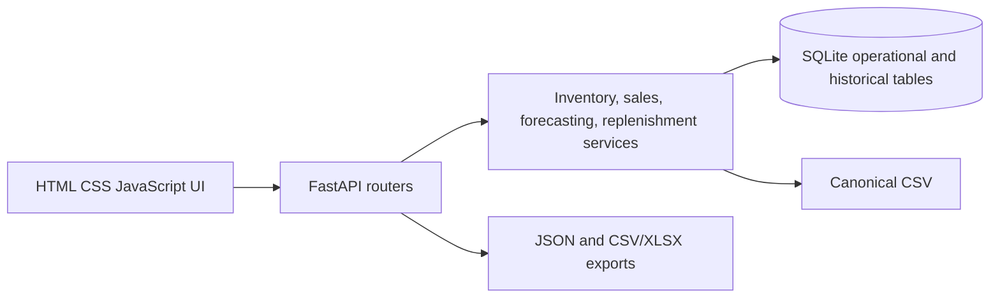
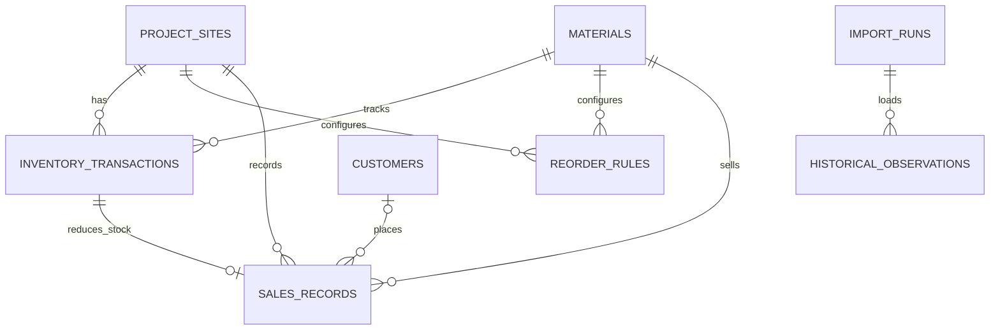

# SiteStock Project Report

## Problem statement
Construction sites must track material receipts, consumption, balances, sales, and replenishment. This project demonstrates a local inventory workflow with weekly demand forecasting for materials and site pairs.

## Objectives
- Maintain a transaction-based inventory ledger with idempotent writes and unit checks.
- Show stock balances, low-stock rules, sales, purchasing, and exports.
- Compare forecasts against Naive baselines with time-aware evaluation.
- Keep forecast guidance separate from recorded stock and cost evidence.

## Brief related work
Classical forecasting treats naïve and seasonal-naïve predictions as essential benchmarks. Time-series cross-validation evaluates candidate methods using expanding training windows and later observations. Inventory control commonly uses lead-time demand plus a safety-stock buffer. SiteStock implements a simple transparent version of these ideas for a demonstration.

## Dataset
The 8,940-row CSV contains 60 site/material series, 149 weekly observations per series, with timestamps from 2024-01-01 through 2026-11-02. Column definitions, scenario assumptions, and the file hash are in DATASET_CARD.md. Quality evidence is in DATASET_AUDIT.md.

## Methodology
The target is weekly consumption quantity for each site/material series. Candidates are Naive, Seasonal Naive, Multiple Linear Regression, Random Forest, and XGBoost when available. Features are prior lags 1–4, trailing four-period mean, and trailing four-period standard deviation. Three expanding-window rolling origins before the final chronological 20% select a method by MAE. All candidates use identical holdout windows per series. Final holdout reports MAE, RMSE, and WAPE; no random split is used. Learned models fall back to Naive when validation MAE does not beat Naive. The forecast interval uses the 90th percentile of pre-holdout rolling-origin absolute errors.

## Results
Measured metrics, model-choice counts, worst-performing pairs, and per-series results are in MODEL_RESULTS.md and model_metrics.json. Naive was selected for 39 of 60 pairs. The evidence does not justify claiming consistent improvement over the baseline.

## Inventory policy evaluation
The live replenishment calculation is transparent: lead-time demand plus safety stock, less usable stock and eligible incoming quantity, followed by minimum-order, order-multiple, and maximum-stock checks. Safety stock is historical mean daily demand multiplied by configured safety-stock days. A stock-out/holding-cost comparison is not reported because the dataset has no carrying-cost rate or shortage-penalty rate; selecting those would add unsupported assumptions.

## Architecture

## ER diagram

## Limitations
This dataset is self-created and simulated under stated assumptions; it is not real observed site data. The history is short and scenario-based, and it lacks verified supplier terms, external weather or project progress, actual carrying costs, and shortage penalties. Model performance on this dataset cannot establish field performance. The live app withholds numeric replenishment recommendations when its demand source is stale.

## Future work
Obtain verified site-level demand, receipt, supplier, price, carrying-cost, and shortage-cost records. Re-evaluate with enough history to test annual seasonality, then validate inventory-policy outcomes with stakeholders before using purchasing recommendations operationally.

## Conclusion
SiteStock demonstrates an integrated inventory workflow and a chronological model comparison. The honest model choice is per-series validation with Naive fallback. The evidence supports a teaching and demo submission, not deployment for live purchasing.
