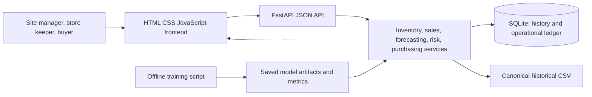
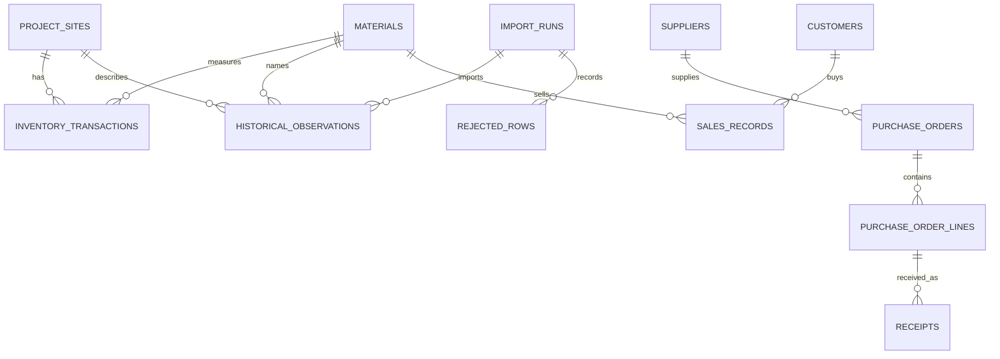

# SiteStock Project Explained

## A beginner guide and viva coach

This guide explains the SiteStock construction-material inventory project from the data file to the web app. It uses the files and saved results in this project. The central conclusion is simple: SiteStock demonstrates how stock records, demand forecasts, and inventory rules can work together. The data is simulated, and the results do not prove that the system is ready to place real orders.

**For:** a student with basic Python knowledge preparing to explain the project.  
**How to read:** follow Parts 0–13. Read the “Viva answer” lines out loud. All paths below are relative to the project root unless a full path is shown.

> **Important honesty note**  
> The 8,940-row dataset is self-created and simulated from stated assumptions. Its prices use published 2026 market references plus explicit adjustments. These prices are indicative, not official rates, invoices, or supplier quotes. Naive forecasting performed strongly and was selected in most series. In the policy replay, the selected-model policy had lower assumed total cost than the other policies, but its service level was not clearly best. The replay does not show real savings.

## Table of contents

0. How to use this guide and one-page summary  
1. The big picture  
2. Basic ideas  
3. The dataset  
4. The database  
5. Machine learning and forecasting  
6. Inventory rules and risk  
7. Policy simulation  
8. How the software is built  
9. How to run the project on Windows  
10. Decisions and reasons  
11. Limits and future work  
12. Viva preparation  
13. Glossary and file map  
Appendix A. Source check

## Part 0. How to use this guide

### A study plan

| Time available | What to do |
|---|---|
| 2 hours | Spend 15 minutes on Parts 0–1; 25 on Parts 2–4; 35 on Parts 5–7; 20 on Parts 8–11; 25 on the 50 questions and speeches. Say the 10-line cheat sheet without looking. |
| 1 day | Read Parts 0–8 once. Recreate the worked examples with a calculator. Run through the 50 questions. Take a break, then give the 2-minute speech from memory and use the 5-minute speech to check details. |

### One-page project summary

| Prompt | Simple answer |
|---|---|
| Project name | SiteStock: a local construction-material inventory and operations demonstration for Dehradun. |
| Problem | A site can run out of cement, steel, or sand, or hold too much stock. Either can cost money or delay work. |
| Main users | Site managers review risk and stock; store keepers record receipts and usage; purchase officers manage suppliers and purchase orders. |
| Data | 8,940 weekly rows; six site identifiers; ten materials; 60 site/material series; 149 rows in each series; 2024-01-01 to 2026-11-02. |
| Data truth | The records are self-created simulated examples. The price base uses dated published 2026 references and documented adjustments. It is not verified site or purchase data. |
| Main technology | Python, FastAPI, SQLAlchemy, SQLite, HTML, CSS, JavaScript, and scikit-learn. XGBoost is optional. |
| Forecast target | Weekly material consumption for one site and one material. |
| Forecast result | Naive was selected in 39 of 60 series. Selected-model average holdout MAE was 65.733 units, with units differing by material. Selected-model WAPE was 34.046%; mean observed coverage of nominal 90% intervals was 94.94%. |
| Inventory result | One shared risk function calculates High/Medium/Low, coverage, reorder point, and an order suggestion. Unknown live stock does not get a numeric stock-aware order. |
| Policy replay | At 20% annual holding cost and a 2× unit-price shortage penalty, selected-model cost averaged ₹588,380 per series, Naive ₹656,508, and fixed reorder point ₹634,388. Fixed reorder point had slightly better fill: 92.83% versus 92.59% for selected-model. These are simulated assumptions, not real savings. |
| Readiness | Dataset, saved model evaluation, and database checks have evidence. A full test run and clean live-browser/API check remain unverified in the recorded environment. |

**Viva answer:** “SiteStock is a teaching demonstration that joins a simulated weekly demand dataset, saved forecasts, operational stock records, and explainable replenishment rules. The main result is that a simple Naive forecast was often competitive, so I do not claim that machine learning always improves the forecast.”

## Part 1. The big picture

### 1.1 The problem and the people

**In one line:** The app helps a construction team record stock and think ahead about replenishment.

A site manager does not want the cement store to become empty just before monsoon work. Buying too much cement also ties up cash and storage space. A store keeper needs to record what arrived and what left. A purchase officer needs suppliers, purchase orders, and receipt status. SiteStock puts these tasks into one local app and keeps its historical teaching data separate from the live stock ledger.

| Person | What they do in the demonstration |
|---|---|
| Site manager | Checks the dashboard, available balances, alerts, forecast view, and replenishment suggestions. |
| Store keeper | Records a physical opening count, receipts, consumption, or adjustment in the operational ledger. |
| Purchase officer | Adds suppliers, reviews purchase orders, changes order status, and records received quantities. |

**Why this design:** one record of stock movements reduces disagreement about the balance. Forecasts give a demand estimate. Rules turn stock, demand, lead time, and uncertainty into a transparent suggestion. A spreadsheet could store rows, but it would not by itself provide the same transaction checks, linked records, and API/UI workflow.

**Small example:** if a store starts with 100 cement bags, receives 50, and issues 30, the recorded balance is 120 bags. The project uses this same stock-flow idea.  
**Where:** `inventory_app/inventory.py`, `inventory_app/models.py`, `api/routes_inventory.py`, `frontend/app.js`.  
**Viva answer:** “The manager reviews risk, the store keeper records movements, and the purchase officer handles suppliers and orders.”

### 1.2 What the system does in six lines

1. Stores sites, materials, and units.
2. Records stock movements and sales in SQLite.
3. Reads a separate CSV of simulated weekly history.
4. Evaluates forecasts and saves the model assessment offline.
5. Applies shared inventory risk rules to demand, stock, lead time, and incoming supply.
6. Shows reports and can turn a replenishment recommendation into a draft purchase order.



**Viva answer:** “The browser calls FastAPI; FastAPI calls Python services and SQLite. A separate script trains and saves forecasts so a page request does not need to fit all models.”

## Part 2. Basic ideas you need first

### 2.1 Inventory words

Think of a small shop owner deciding how many cement bags to keep. That is the same basic problem as a construction store, even though a project site may use much larger quantities.

| Word | Simple meaning and cement example | Why it matters / another option | Example from this project | File and viva answer |
|---|---|---|---|---|
| Inventory / stock | Material held for future use. A cement store's inventory is its usable cement bags. | The app tracks material-specific quantities. A paper register is possible, but harder to validate and report consistently. | Cement is measured in 50-kg bags. | `inventory_app/inventory.py`. “Inventory is the material available for later work.” |
| Stock in / receipt | Material entering the store. | A receipt raises the ledger balance; a CSV history import does not create a receipt. | The source has `incoming_qty`; the operational ledger has explicit receipt movements. | `inventory_app/ingestion.py`, `api/routes_inventory.py`. “A receipt is a recorded stock movement.” |
| Stock out / issue | Material used or otherwise removed. | It lowers available stock. A sale is also a separate business record and movement. | `consumption_qty` records weekly use in the simulated history. | `docs/DATASET_CARD.md`. “Issue means stock left the store.” |
| Closing stock | What remains at the end of the period. | The stock chain can be checked with opening + incoming − consumption. | In the 2026-11-02 Clement Town Cement example: 769.4477 bags estimated closing. | `docs/DATASET_AUDIT.md`. “Closing stock is the remainder after receipts and use.” |
| Lead time | Time between ordering and expected delivery. | Longer wait means more demand can happen before a delivery. | Sample worked cases use source lead times such as 4 days for Cement and 10 days for Tiles. | `supplier_lead_time_days`, `inventory_app/risk.py`. “Lead time is the wait for supply.” |
| Reorder point | Stock threshold that says it is time to replenish. | It includes expected demand while waiting plus a safety buffer. A fixed number is simpler but ignores changing demand. | Cement worked example reorder point: 202.81 bags. | `inventory_app/risk.py`. “At or below the point, risk becomes at least Medium.” |
| Safety stock | Extra stock held for uncertainty. | More safety stock protects service but costs space and money. | Risk examples use the configured 95% service level and saved forecast error. | `inventory_app/risk.py`, `inventory_app/policy_config.py`. “It is a buffer for demand error during lead time.” |
| EOQ | Economic order quantity, a formula balancing order costs and holding costs. | It is used as a cross-check against an order-up-to gap; it is not a guarantee of the best real order. | Default annual holding rate is 20%; order cost varies by material class. | `inventory_app/risk.py`, `inventory_app/policy_config.py`. “EOQ balances ordering often against holding more.” |
| Days of cover | How many days current stock could last at the estimated daily demand. | Easy for a manager to understand; it depends on the demand estimate. | Clement Town Cement: 23.94 days using 224.97 bags/week. | `inventory_app/risk.py`. “Cover is stock divided by daily demand.” |
| Stock-out | Demand cannot be met because stock is insufficient. | It can delay work or require urgent sourcing. | In the default policy replay, selected-model policy averaged 4.87 stock-out weeks. | `docs/POLICY_SIMULATION.md`. “A stock-out week has some unmet demand.” |
| Overstock | More days of stock than the configured limit. | It is shown separately from immediate shortage risk because excess stock and stock-out are different problems. | The default overstock limit is 90 cover days. | `inventory_app/policy_config.py`, `inventory_app/risk.py`. “Overstock is a separate flag, not a replacement risk level.” |
| Service level | Share of demand that was supplied. | A higher target usually requires more buffer stock. | The UI offers 90%, 95%, and 98% for the risk calculation. | `api/routes_replenishment.py`. “Service level is the fraction of demand we aim to satisfy.” |

### 2.2 Forecast and machine-learning words

| Word | Simple meaning | Why it is used / alternative | Project example and path | Viva answer |
|---|---|---|---|---|
| Time series | Values recorded in time order. | Order matters because yesterday comes before today. A normal shuffled table hides that order. | Weekly consumption for one site/material, 149 dates; `inventory_app/forecasting.py`. | “A time series is a list of measurements ordered by date.” |
| Demand | Amount needed or used over a time period. | The model predicts consumption as a practical demand proxy. A real order request series would be better but is not available. | Target: weekly `consumption_qty`. | “Demand here means recorded weekly consumption in the simulated series.” |
| Forecast | An estimate of future values. | Useful for planning, but uncertain. A fixed reorder rule is a simpler comparison. | The API can show forecasts up to its supported horizon; `docs/MODEL_RESULTS.md`. | “A forecast is an estimate, not a promise.” |
| Training | Showing a model past examples so it can learn a pattern. | Needed for learned models. Naive rules do not fit parameters. | Model suite is run by `scripts/train_all.py`. | “Training means fitting the model using earlier observations.” |
| Testing / holdout | Checking a model on later data it did not use to learn or select itself. | It better matches a future prediction. A random split would mix past and future. | 119 train observations and 30 final holdout observations per full series. | “The holdout is a later period kept for a final diagnostic.” |
| Accuracy / error | How close predictions are to actual values. | Several metrics are needed because one number cannot show every kind of miss. | MAE, RMSE, WAPE and MASE are saved in `docs/model_metrics.json`. | “Error is the distance between a prediction and what happened.” |
| Machine learning vs rule | A learned model fits patterns from examples; a rule follows a fixed instruction. | We compare learned methods with simple baselines so complexity must earn its place. | Naive predicts the last value; Random Forest learns tree rules from lag features. | “ML learns from examples; a normal rule follows written logic.” |

## Part 3. The dataset

### 3.1 What is in it

**In one line:** It is a fixed, self-created simulated teaching dataset for weekly construction-material usage.

It contains 8,940 records: six site identifiers × ten materials = 60 site/material series. Every series has 149 weekly observations from 2024-01-01 through 2026-11-02. The file has 16 columns.

| Column | Meaning and unit |
|---|---|
| `date` | Timestamp for the weekly observation. |
| `project_site_id` | Scenario site name, such as Clement Town, Dehradun. |
| `city`, `state` | Location labels. |
| `project_type` | Project category. |
| `project_phase` | Construction stage. |
| `material` | Material name. |
| `unit` | Quantity unit for that material. |
| `consumption_qty` | Quantity used during the observation period, in `unit`. |
| `opening_stock_qty` | Stock at the beginning of the period, in `unit`. |
| `incoming_qty` | Quantity received during the period, in `unit`. |
| `unit_price_inr` | INR per dataset unit. |
| `demand_level` | Low, Medium, or High derived from prior demand history. |
| `price_level` | Low, Medium, or High derived from prior price history. |
| `supplier_lead_time_days` | Scenario lead time in whole days. |
| `wpi_reference_month` | Month key in YYYY-MM form; it contains no index value. |

Material units are pieces for AAC blocks and bricks, kg for binding wire and TMT steel, 50-kg bags for cement, cubic metres for aggregate/sand/concrete, pieces for PVC pipes, and square metres for tiles. Confirm the exact `unit` column for calculations.

### 3.2 Why it is simulated and how it was built

Real site records were not supplied. The project therefore defines scenarios rather than pretending the rows came from actual sites. The data card states that demand uses a bounded seasonal factor of 0.75–1.25 of each series median, a deterministic trend capped at 0.15% per week, and bounded deterministic variation of ±4%. Construction phases change on a 26-week schedule. Lead times are positive whole-day scenario values. Receipts follow a stock-cover rule.

Prices are also scenario estimates. The source note uses a Dehradun dealer-to-retail snapshot dated 12 August 2026, then applies stated November adjustments, site factors, seasonal factors, earlier-year drift, and deterministic noise. The latest-week price is normalized to the configured November target. This is not an official schedule of rates or a supplier quote.

| Material | Dataset mapping and price treatment |
|---|---|
| AAC Blocks | 600×200×200 mm piece; August ₹82; +1%; latest target ₹82.82/piece. |
| Binding Wire | 18-gauge, ₹62/kg; +4%; target ₹64.48/kg. |
| Bricks | Red-clay, ₹9/piece; +1%; target ₹9.09/piece. |
| Cement | OPC 43, 50-kg bag, ₹428; +₹15; target ₹443/bag. |
| Coarse Aggregate | ₹1,289/tonne converted using 1.5 tonnes per cubic metre; +1.5%; target ₹1,962.50/m³. |
| PVC Pipe | 4-inch SWR, ₹348/metre converted to a 3-metre piece; +1%; target ₹1,054.44/piece. |
| Ready-Mix Concrete | M20, ₹5,211/m³; +1.5%; target ₹5,289.17/m³. |
| River Sand | ₹2,478/tonne converted using 1.6 tonnes per cubic metre; +1.5%; target ₹4,024.27/m³. |
| TMT Steel | 12-mm Fe500D, ₹63/kg; +4%; target ₹65.52/kg. |
| Tiles | Vitrified 2×2, ₹87/sq ft converted at 10.7639104167 sq ft/m²; +1%; target ₹945.82/m². |

InfraLens gives the August Dehradun dealer-to-retail anchors. BusinessToday’s 2026-09-29 report supports the cement adjustment context; Business Standard (2026-10-02) and SMM (2026-10-23) provide regional steel context. The chosen category adjustments are scenario decisions because those reports do not quote every matching Dehradun item. The Uttarakhand PWD SOR is mentioned as a future benchmark, not used as the dealer price source. Cement grade, exact product sizes, density conversions, and tile finish are assumptions where the dataset lacks that detail.

**Why these choices:** the project needs a repeatable sample to demonstrate import, forecasts, and inventory arithmetic. It could use a public benchmark dataset, but no matching site-level weekly history was available. A simulated file allows a reproducible workflow while limiting claims to demonstration.

**Tiny real-number example:** the latest Cement anchor is ₹443 per 50-kg bag. In the audit, the observed historical range across sites and dates is ₹383.2649–₹471.3244 per bag. The range is not a set of verified purchases.

**Where:** `docs/DATASET_CARD.md`, `docs/PRICE_SOURCES.md`, `inventory_app/price_config.py`, `scripts/build_dataset.py`.  
**Viva answer:** “The dataset is simulated because real site histories were unavailable. Prices are indicative references built from dated sources and disclosed conversions, not official rates.”

### 3.3 Data quality and labels

The natural key is `(project_site_id, material, date)`. The audit reports zero missing values across 16 columns, zero duplicate rows and natural keys, a seven-day cadence, no invalid numeric values, no negative calculated closing stock, and zero mismatches in 8,880 adjacent stock-chain comparisons at tolerance 1e-6. There are 250 Tukey IQR consumption flags; they are retained because a statistical flag alone does not prove a record is wrong. Historical prices are bounded by the documented material checks.

The stock equation is: **closing = opening stock + incoming − consumption**. For example, the first CSV row has 5,092.62 pieces opening, 486 received, and 143 consumed, so calculated closing is 5,435.62 pieces. The next observation opens at 5,435.62.

Demand/price labels use an expanding history in the same site/material series. Until 12 earlier values exist, the label is Medium. Then the current value is compared with the earlier values’ 33rd and 67th percentiles. Below the 33rd is Low; above the 67th is High; ties and the middle are Medium. “Past-only” means the current/future observations do not set the threshold for that row, which prevents future information from changing a past label.

**Where:** `docs/DATASET_AUDIT.md`, `inventory_app/levels.py`, `inventory_app/data_quality.py`.  
**Viva answer:** “The audit checks missing values, duplicates, seven-day cadence, valid units and the stock equation; all 8,880 adjacent stock links matched within 1e-6.”

## Part 4. The database

### 4.1 Why a database and what connects

The CSV is historical analysis input. SQLite stores both imported historical observations and separate operational records. Foreign keys link transactions to a site/material and purchase-order lines to suppliers and orders. Unique keys stop duplicate history and repeated requests from silently creating duplicate activity.



The main tables include `project_sites`, `materials`, `historical_observations`, `import_runs`, `rejected_rows`, `inventory_transactions`, `reorder_rules`, `suppliers`, `purchase_orders`, `purchase_order_lines`, `receipts`, `customers`, `sales_records`, `forecast_artifacts`, `application_settings`, and `schema_version`.

**Why SQLite:** the project is a single-user local demonstration and does not need a separate database server. PostgreSQL could support a larger multi-user deployment, but needs service setup. SQLite’s trade-off is simpler setup with less suitability for heavy concurrent operations.

**Viva answer:** “The CSV stores historical sample rows; SQLite stores app records with keys, transactions, and integrity checks. Importing history never creates current stock movements.”

### 4.2 Schema version, imports, backups, evidence

Schema version 6 is the current database layout number, recorded in `schema_version`. Initialization creates missing tables, applies additive migrations, checks for existing columns, and brings the version forward. Migration 6 adds `demand_level` and `price_level` to historical observations; it also removes the redundant historical source label. Operational source tags remain internal.

`scripts.init_database` creates/updates the schema and imports the canonical CSV idempotently, using a file hash to avoid repeated imports. Before data/schema edits, the review used a SQLite online backup. `DB_VERIFICATION.md` reports schema 6, CSV/database counts matching at 8,940, 60 series, no duplicate keys, SQLite `integrity_check` = `ok`, no foreign-key violations, and zero stock-chain mismatches. A fresh-install smoke check imported the history without making operational stock movements.

**Where:** `inventory_app/database.py`, `inventory_app/models.py`, `inventory_app/ingestion.py`, `scripts/init_database.py`, `docs/DB_VERIFICATION.md`.  
**Viva answer:** “Migrations let the database structure change safely over time. Schema v6 stores the two past-only level labels; integrity and foreign-key checks passed.”

## Part 5. Machine learning and forecasting

### 5.1 Why forecasting matters and what is actually used

If weekly cement use is rising, waiting until the shelf is nearly empty may be too late because a supplier needs lead time. A forecast estimates future use; the inventory rule combines it with lead time and a safety buffer.

The implemented feature row contains six numeric values: lag 1, lag 2, lag 3, lag 4, the mean of the last four observations, and the population standard deviation of those four observations. A lag is a past value. The model uses only past consumption. Although a calendar feature or price/weather inputs could be useful future work, the current per-series model does **not** use week of year, monsoon flags, peak-season flags, price, or price change. Do not claim those are model features in a viva.

**Why these features:** recent usage and its short-term level/variation are available from the series and can be calculated without outside data. A richer model could use site progress, weather, or price, but those fields are not reliable explanatory observations here.  
**Example:** at a forecast origin, lag 1 is last week’s cement use; rolling mean is the average of the latest four weeks.  
**Where:** `inventory_app/forecasting.py::feature_row`, `training_matrix`.  
**Viva answer:** “The fitted models use four past lags, a four-week mean, and a four-week standard deviation. They do not use weather, monsoon, calendar flags, or prices.”

### 5.2 The five candidate models

| Model | Plain explanation | Why include it | Weakness |
|---|---|---|---|
| Naive | Predicts the last observed value. | Simple baseline that is hard to fool. | It cannot anticipate a real turning point. |
| Seasonal Naive | Predicts the value from one seasonal cycle earlier; weekly code uses 52 weeks. | Checks whether an annual repeat is more useful than the last value. | A 52-week value may not match the present construction phase. |
| Multiple Linear Regression | Fits a weighted straight-line combination of the six features. | Easy to inspect and provides a basic learned model. | It only captures linear relationships and can be unstable on short histories. |
| Random Forest | A group of decision trees averages predictions from feature patterns. | Can model non-linear patterns without one straight-line relationship. | Can overfit limited examples and is less direct to explain. |
| XGBoost | Builds trees in sequence, each correcting earlier errors. | A stronger boosting candidate when the optional library is available. | More complexity; still limited by the small simulated series. |

The saved evaluation had all five models available. XGBoost is optional in installation (`requirements-optional-ml.txt`). If it cannot be imported, the app reports the supported remaining models.

### 5.3 Time-aware validation and leakage

For each 149-observation series, the report uses 119 earlier training observations and 30 later holdout observations. Before the holdout, three expanding-window origins compare model error. The selected model is chosen on the mean rolling-origin MAE, not on the final 30 weeks. The code only keeps a learned model if its pre-holdout selection MAE beats Naive.

**Data leakage** is accidentally using future information. Example: if a rolling average for week 10 includes week 11 consumption, the model has learned from the future. The code’s `feature_row(values[:index])` passes only values strictly before the target index. Recursive forecasting then appends its own prediction before predicting the next step. This preserves the past-to-future order.

Random train/test splitting is a poor fit because it could let later periods influence a model evaluated on earlier periods. The chronological split keeps the test period later in time. Preprocessing for linear regression is packaged with the estimator and fitted on the training examples.

**Where:** `inventory_app/forecasting.py`, `docs/MODEL_RESULTS.md`.  
**Viva answer:** “We split by date. Features use only earlier consumption, so the forecast does not see the value it is trying to predict.”

### 5.4 Four error measures, in simple words

| Metric | Words first | Formula | What to remember |
|---|---|---|---|
| MAE | Average size of the miss. | Add each absolute error and divide by the number of predictions. | Same unit as material, so a cement MAE is bags. |
| RMSE | Like MAE, but large misses count more. | Square each error, average the squares, then take the square root. | A few large mistakes raise it. |
| WAPE | Total absolute miss as a share of total actual use. | Sum of absolute errors ÷ sum of actual quantities × 100%. | Percentage; calculated within each series, then averaged. |
| MASE | MAE compared with a training-history seasonal-naive error scale. | MAE ÷ mean absolute difference between training values 52 weeks apart (weekly series). | Dimensionless; below 1 means the tested MAE is smaller than that training scale. |

MASE looked small next to WAPE, so its code was checked. In `inventory_app/forecasting.py::_calculate_metrics`, weekly MASE divides MAE by the mean absolute difference between training values 52 periods apart. A small denominator scale can make MASE small; it is not a percent. It is not the same as dividing by average demand. This is a material detail to explain, not evidence by itself of an error.

**Worked arithmetic, with a verified series:** for Clement Town Cement, the saved selected model is Naive, MAE 53.87 bags/week, WAPE 25.88%, MASE 0.21. By the implementation, its implied seasonal scale is approximately `53.87 ÷ 0.21 ≈ 256.5` bags. The displayed MASE is rounded, so this arithmetic is illustrative; the unrounded metrics are in `docs/model_metrics.json`. WAPE’s denominator is total actual holdout consumption, not the same seasonal scale.

**Where:** `inventory_app/forecasting.py::_calculate_metrics`, `docs/MODEL_RESULTS.md`, `docs/model_metrics.json`.  
**Viva answer:** “MASE is scaled by the training seasonal-naive error at a 52-week lag. It is dimensionless and is not a percent; that is why it can look numerically small beside WAPE.”

### 5.5 Results, uncertainty, and model explanation

| Model | Mean holdout MAE | RMSE | WAPE | MASE |
|---|---:|---:|---:|---:|
| Naive | 65.219 | 73.825 | 30.282% | 0.148 |
| Seasonal Naive | 305.374 | 441.371 | 87.732% | 0.312 |
| Multiple Linear Regression | 182.116 | 205.218 | 106.356% | 0.342 |
| Random Forest | 104.968 | 116.344 | 63.066% | 0.179 |
| XGBoost | 80.536 | 93.348 | 47.128% | 0.166 |
| Selected per series | 65.733 | 74.040 | 34.046% | 0.150 |

These are macro averages across 60 series. The quantities mix pieces, kg, bags, m³, and m²; MAE and RMSE across that mix are only arithmetic summaries, not one physical unit. WAPE and MASE are averaged per series rather than pooled across unlike materials.

Naive was selected for 39 series, XGBoost for 13, Random Forest for 6, and Multiple Linear Regression for 2. The selected-model holdout MAE (65.733) is slightly above all-series Naive MAE (65.219); the selected result is **not** a claim that the selection rule improved the overall holdout score. The rule selects on earlier rolling-origin periods. In this simulated sample, repeated patterns and short histories make the last value a strong competitor.

A prediction interval is a range around a forecast. For each selected model, the code takes the 90th percentile of absolute pre-holdout rolling-origin errors, then places that radius below and above the forecast (the lower bound is clipped to zero). It is an empirical band, not a promise. Mean observed coverage on the final holdout was 94.94% for selected models, although coverage differs by model and series. This estimate can inform buffer size but does not guarantee future service.

Feature importance for Random Forest is tree impurity importance for the six features. It can show which inputs the fitted trees used more often to reduce error. It does not prove cause and effect. `docs/model_metrics.json` provides per-series details; the report describes the best/worst pair context but does not establish field performance.

**Offline training:** `scripts/train_all.py` fits comparisons and saves assessments and model artifacts. The recorded earlier request-time training path stalled the page/API when artifacts were missing. Current requests load saved assessments or return a lightweight Naive fallback; they do not fit the full candidate suite during a page request. A recorded offline run trained 60/60 pairs, wrote 300 artifacts, and reported zero issues in 221.86 seconds.

**Where:** `docs/MODEL_RESULTS.md`, `docs/model_metrics.json`, `inventory_app/forecasting.py`, `scripts/train_all.py`, `api/routes_forecasting.py`.  
**Viva answer:** “Naive won 39 of 60 pairs. ML did not always beat it. The selected holdout average was not lower than Naive’s, so I report that limitation directly.”

## Part 6. Inventory logic and risk

### 6.1 Formulas

The words come first: estimate how much will be used before the order can arrive, add a buffer for forecast error, and compare that requirement with stock and incoming supply.

| Name | Formula in words | Formula |
|---|---|---|
| Lead-time demand | Weekly demand × lead time measured in weeks. | `D × L` |
| Safety stock | Service-level z value × weekly forecast-error spread × square root of lead weeks. | `z × σ × √L` |
| Reorder point | Lead-time demand plus safety stock. | `D × L + z × σ × √L` |
| Days of cover | On-hand stock divided by estimated daily demand. | `stock ÷ (D ÷ 7)` |
| Order-up-to target | Weekly demand for lead time plus one review week, plus safety stock. | `D × (L + 1) + safety stock` |
| Positive order-up-to gap | Target less on-hand and eligible incoming; not below zero. | `max(0, target − stock − incoming)` |
| EOQ cross-check | Square root of twice annual demand times order cost, divided by unit value times annual holding rate. | `√(2 × annual demand × order cost ÷ (unit price × holding rate))` |

At the default 95% service target, the z value is about 1.645. Risk output chooses the larger of the positive order-up-to gap and EOQ, then applies the minimum quantity and rounds up to the material’s configured pack. An incoming delivery counts only if its unit/status/date make it eligible. The default annual holding rate is 20%; the overstock threshold is more than 90 days of cover.

**Why:** a reorder point protects against demand while waiting. A safety buffer reduces, but cannot eliminate, shortage risk. EOQ offers a second quantity candidate. A fixed quantity alone is simpler but ignores demand variation and item value.

### 6.2 Exact risk precedence and suggestions

Rules are applied in this order:

1. **HIGH:** on-hand, demand, or lead-time input is missing; stock is negative; stock is below safety stock; or days of cover is strictly below lead time.
2. **MEDIUM:** stock is at/below the reorder point; or cover is at most 1.25 times lead time; or the forecast interval relative width is at least 1.0.
3. **LOW:** none of those rules matched. The explicit zero-demand and zero-error case is Low.

The overstock flag is separate: it is true above 90 days of cover. A non-High overstock case says “Reduce next order” and reports an amount to reduce; it does not rewrite the High/Medium/Low label. Missing stock gets High but no numeric order quantity because the current balance needs a physical count.

| Risk | Suggestion | Date behavior |
|---|---|---|
| High with usable inputs | Order now; quantity rounded to pack. | Order-by is today; expected arrival is today + lead time. |
| Medium near the lead-time boundary | Order soon. | Latest date before coverage expires, bounded at today. |
| Other Medium | Plan order. | Uses the same coverage-based planning date. |
| Low | Hold; zero quantity. | No order date. |
| Overstock without High risk | Reduce next order; zero current suggested quantity plus reduction amount. | No order date. |
| Missing/invalid stock | Show High and ask for count/correction; withhold number. | No numeric stock-aware recommendation. |

Confidence uses forecast interval width relative to demand: below 0.5 is Narrow; 0.5 or above is Wide. A relative width at least 1.0 raises risk to at least Medium. Confidence is an uncertainty label, not a guarantee.

### 6.3 Three worked examples from the simulated project rows

These examples use the latest CSV row dated 2026-11-02. The stock shown is calculated closing stock (`opening + incoming − consumption`). Weekly demand is the mean of the last four observations, following the dashboard baseline. Error spread comes from the saved selected-model assessment in `docs/model_metrics.json`. The risk helper’s lead-time, service, and pack rules are then applied with no incoming delivery. This is a reproducible teaching calculation from simulated rows, **not a current physical count** and not the same as live dashboard risk, which uses the operational ledger.

#### Example A: HIGH risk, Clement Town Tiles

Inputs from the latest row and saved metrics: estimated closing = 129.19 m²; four-week demand = 38.84 m²/week; selected model = Naive; error sigma = 92.98 m²/week; lead time = 10 days = 1.4286 weeks; unit reference = ₹945.8248/m². Use order cost ₹500 (finishes class), 20% holding, pack size 1 m², and 95% service.

1. `lead demand = 38.84 × 1.4286 = 55.49 m²`.
2. `safety stock = 1.6449 × 92.98 × √1.4286 ≈ 182.79 m²`.
3. `reorder point = 55.49 + 182.79 = 238.28 m²`.
4. `cover = 129.19 ÷ (38.84 ÷ 7) ≈ 23.29 days`. This is above the 10-day lead, but stock is below safety stock (129.19 < 182.79), so rule 1 makes it HIGH.
5. Target `= 38.84 × (1.4286 + 1) + 182.79 ≈ 277.10 m²`; gap `= 277.10 − 129.19 ≈ 147.91 m²`.
6. EOQ is about `√(2 × (38.84 × 52) × 500 ÷ (945.8248 × 0.20)) ≈ 103.3 m²`. The larger candidate is the gap, so pack-rounded order is 148 m².

**Action:** Order now. This explains the rule; it is not an instruction to buy tiles from this simulated balance.  
**Where:** CSV row for Clement Town/Tiles/2026-11-02; matching selected-model entry in `docs/model_metrics.json`; `inventory_app/risk.py`; `inventory_app/policy_config.py`.

#### Example B: MEDIUM risk, GMS Road Tiles

Latest-row inputs: estimated closing = 172.20 m²; four-week demand = 34.37 m²/week; selected model = Multiple Linear Regression; error sigma = 81.13 m²/week; lead time = 10 days = 1.4286 weeks; price ₹945.8248/m². Same finishes order cost ₹500, 20% holding, pack 1 m².

1. `lead demand = 34.37 × 1.4286 ≈ 49.10 m²`.
2. `safety stock = 1.6449 × 81.13 × √1.4286 ≈ 159.51 m²`.
3. `reorder point ≈ 49.10 + 159.51 = 208.61 m²`.
4. `cover = 172.20 ÷ (34.37 ÷ 7) ≈ 35.07 days`. It is more than 1.25 × 10 days, but stock is at/below the reorder point, so rule 2 makes it MEDIUM.
5. Target `= 34.37 × (1.4286 + 1) + 159.51 ≈ 243.00 m²`; gap ≈ 70.80 m².
6. EOQ `≈ √(2 × (34.37 × 52) × 500 ÷ (945.8248 × 0.20)) ≈ 97.2 m²`. EOQ is larger, rounded upward to 98 m².

**Action:** Plan order, because 35.07 days of cover is not within the 12.5-day “order soon” threshold.  
**Where:** CSV row for GMS Road/Tiles/2026-11-02; `docs/model_metrics.json`; `inventory_app/risk.py`.

#### Example C: LOW risk, Clement Town Cement

Latest-row inputs: estimated closing = 769.45 bags; four-week demand = 224.97 bags/week; selected model = Naive; sigma = 59.72 bags/week; lead time = 4 days = 0.5714 weeks; reference ₹443/bag. Cement order cost ₹500; pack size 50 bags.

1. `lead demand = 224.97 × 0.5714 ≈ 128.55 bags`.
2. `safety stock = 1.6449 × 59.72 × √0.5714 ≈ 74.26 bags`.
3. `reorder point ≈ 128.55 + 74.26 = 202.81 bags`.
4. `cover = 769.45 ÷ (224.97 ÷ 7) ≈ 23.94 days`. Stock is above the reorder point and well above safety stock; the risk is LOW.
5. Risk helper returns quantity 0 and action Hold. It does not calculate a purchase quantity for a Low case.

**Where:** CSV row for Clement Town/Cement/2026-11-02; selected-model metrics; `inventory_app/risk.py`.  
**Viva answer:** “The High example is below safety stock, Medium is at the reorder point, and Low has stock comfortably above the point. These are simulated snapshots, not real site counts.”

### 6.4 Why share one risk module

`inventory_app/risk.py::calculate_inventory_risk` is used by the dashboard and `/api/replenishment/calculate`; one implementation avoids different thresholds in different screens. The UI displays the API result rather than recalculating it in JavaScript. The general replenishment service also has a separate explicit-input function in `inventory_app/replenishment.py`; it estimates rates and eligible pipeline with a different workflow. Explain which endpoint/rule you mean if asked. The project’s shared risk explanation is the `risk.py` calculation.

**Viva answer:** “The dashboard and risk endpoint call the same Python function, so they share one precedence and one set of formulas. The browser only displays the result.”

## Part 7. Policy simulation: does ML actually help?

The simulation replays the same final 30 chronological holdout weeks for 60 series. It compares: (1) selected forecast policy, (2) Naive forecast policy, and (3) a fixed reorder point using training-only trailing 52-week mean and one-step-change spread. Policies begin from the same training-only one-review-cycle target, review weekly, order in configured material packs, and wait for configured lead time. The replay writes no live transactions.

Cost assumptions are annual holding rates 15%, 20%, and 30% of reference value; shortage penalties 1.5×, 2×, and 3× reference unit price; and fixed per-order costs by material class. These are scenario assumptions because the data has no verified carrying cost, supplier fee, or shortage penalty. The price base is indicative, not audited procurement cost.

| Policy at 20% holding and 2× shortage | Fill/service level | Stock-out weeks | Orders | Total cost, mean per series |
|---|---:|---:|---:|---:|
| Selected model | 92.59% | 4.87 | 15.87 | ₹588,380 |
| Naive | 91.24% | 5.87 | 16.43 | ₹656,508 |
| Fixed reorder point | 92.83% | 4.22 | 14.13 | ₹634,388 |

**Honest conclusion:** under this particular synthetic data and cost setting, selected-model policy had the lowest simulated total cost. The fixed rule had slightly higher service and fewer stock-out weeks than selected-model policy. So ML showed lower assumed cost, but not clearly better service. Change the assumed cost rates and the comparison may change. This is not observed savings or a real purchasing recommendation.

**Where:** `docs/POLICY_SIMULATION.md`, `docs/policy_simulation_summary.json`, `docs/policy_simulation.csv`, `scripts/simulate_inventory_policies.py`, `inventory_app/policy_config.py`.  
**Viva answer:** “Selected-model cost was lower under the default assumptions, but the fixed rule had a slightly better fill rate. The cost inputs are assumptions and all rows are simulated.”

## Part 8. How the software is built

### 8.1 Folders and important files

| Path | What it does |
|---|---|
| `api/` | FastAPI routes, request/response schemas, errors, serialization, app entry point. |
| `inventory_app/` | Business rules for data, database, inventory, sales, forecasting, risk, procurement, pricing, and reports. |
| `frontend/index.html` | Main page shell. |
| `frontend/styles.css` | Screen layout and visual styles. |
| `frontend/app.js` | Navigation, data loading, forms, and API calls. |
| `frontend/vendor/plotly.min.js` | Locally bundled chart library. |
| `data/construction_materials_dehradun_dataset.csv` | Canonical simulated historical input. |
| `data/inventory.db` | Default SQLite database. |
| `artifacts/models/` | Saved model files used by the app. |
| `docs/` | Data card/audits, price sources, metrics, policy output, review evidence, viva notes. |
| `scripts/build_dataset.py` | Rebuilds and validates the canonical dataset. |
| `scripts/init_database.py` | Initializes schema and imports the canonical history. |
| `scripts/train_all.py` | Runs offline model comparison and saves artifacts/metrics. |
| `scripts/simulate_inventory_policies.py` | Replays replenishment policies on saved holdout predictions. |
| `tests/` | Unit, API, database, ingestion, and UI smoke checks. |

### 8.2 Pages and what actions do

| Page | What a person does | Main API calls |
|---|---|---|
| Dashboard | Filter site/material/date, review balances, alerts, risk and separate historical/operational trends. | `GET /api/dashboard`, `GET /api/catalog` |
| Inventory | Filter balances, add receipt/issue/adjustment movements, view ledger, set reorder rule. | `GET /api/inventory/balances`, `GET /api/inventory/transactions`, `POST /api/inventory/transactions`, `GET/PUT /api/reorder-rules` |
| Sales | Filter sales, add a sale, add customers. Margin is shown only when recorded cost is complete. | `GET/POST /api/sales`, `GET/POST /api/customers` |
| Forecasting | Choose a site/material and frequency, evaluate or open saved comparison and metadata. | `GET /api/forecast-sources`, `GET /api/forecasts/leaderboard`, `POST /api/forecasts/evaluate`, `GET /api/forecasts/metadata` |
| Replenishment | Choose inputs/service level, calculate a suggestion, optionally create a draft purchase order. | `GET /api/inventory/balances`, `GET/PUT /api/reorder-rules`, `GET /api/suppliers`, `POST /api/replenishment/calculate`, `POST /api/purchase-orders/from-recommendation` |
| Purchasing | Add suppliers, review purchase orders, submit/approve, receive goods. | `GET/POST /api/suppliers`, `GET /api/purchase-orders`, `POST /api/purchase-orders/from-recommendation`, `PATCH /api/purchase-orders/{id}/status`, `POST /api/receipts` |
| Data & Reports | Validate and preview CSV, explicitly confirm historical import, inspect quality/import history, download CSV/XLSX reports. | `GET /api/data/quality`, `GET /api/data/imports`, `POST /api/data/validate`, `POST /api/data/import`, `/api/reports/*` |
| Catalogue / settings | Add or update sites/materials/customers and active status where available. | `GET/POST/PATCH /api/sites`, `/api/materials`, `/api/customers`; `GET /api/catalog` |

Button behavior is visible in `frontend/app.js`: evaluate sends the selected forecast form to the API; validate previews a CSV; confirm import posts only after the user checks the confirmation box; receive remaining posts a receipt and updates stock. Purchase order status buttons move Draft to Pending approval and then Approved. No historical import button creates stock transactions.

### 8.3 API endpoints

All routes below are prefixed with `/api` except the root static site. Query/body validation uses FastAPI/Pydantic; structured errors include an error code, message, and details.

| Method | Path | Purpose |
|---|---|---|
| GET | `/health` | Database query plus schema/table/dataset parity checks. |
| GET | `/diagnostics` | Current checks and startup diagnostics. |
| GET | `/catalog` | Combined active catalog. |
| GET/POST/PATCH | `/sites`, `/sites/{site_id}` | List, add, or update site. |
| GET/POST/PATCH | `/materials`, `/materials/{material_id}` | List, add, or update material. |
| GET/POST/PATCH | `/customers`, `/customers/{customer_id}` | List, add, or update customer. |
| GET | `/dashboard` | Dashboard values, including risk summary. |
| GET | `/data/quality`, `/data/imports` | Quality summary and import log. |
| POST | `/data/validate`, `/data/import` | Validate/preview then import historical CSV. |
| GET | `/inventory/balances`, `/inventory/transactions` | Current ledger balances and movement list. |
| POST | `/inventory/transactions` | Record a stock movement. |
| GET/PUT | `/reorder-rules`, `/reorder-rules/{site_id}/{material_id}` | Read or save site/material reorder settings. |
| GET | `/sales` | List sales. |
| POST | `/sales` | Record sale and cost accounting. |
| GET | `/forecast-sources`, `/forecasts/leaderboard`, `/forecasts/metadata` | Source descriptions, saved comparisons, and metadata. |
| POST | `/forecasts/evaluate` | Load saved assessment or evaluate supported forecast request. |
| POST | `/replenishment/calculate` | Calculate shared stock-risk/order recommendation. |
| GET/POST | `/suppliers` | List or add suppliers. |
| GET | `/purchase-orders` | List purchase orders. |
| POST | `/purchase-orders/from-recommendation` | Create draft order from displayed recommendation. |
| PATCH | `/purchase-orders/{order_id}/status` | Change purchase order status. |
| POST | `/receipts` | Record received goods and stock ledger entry. |
| GET | `/reports/ledger.csv`, `/sales.csv`, `/current-inventory.csv`, `/historical.csv`, `/forecast-metadata.csv`, `/quality.csv` | Download CSV report. |
| GET | `/reports/workbook.xlsx` | Download combined workbook. |

The app logs startup checks and unhandled errors to `logs/app.log`. It turns known API problems into structured HTTP errors, validation errors into 422 responses, and unexpected errors into a generic 500 with the traceback in the log. `/api/health` and `/api/diagnostics` check startup/database readiness. The documented browser check found an old process on port 8000: its health response lacked the current checks, `/api/diagnostics` returned 404, and dashboard returned 500. A clean current-server HTTP check is still needed.

### 8.4 What the tests check and what is known

Tests cover API behavior, migrations, CSV source integrity, forecasts, imports/data quality, inventory calculations, procurement, reorder rules, replenishment settings, reports, risk boundaries, sales, sample pipeline, and UI smoke behavior. `docs/COMPLETION_REPORT.md` records that compileall and JavaScript syntax checks passed; 15 focused dataset/risk/ingestion tests passed; a broader database/calculation subset had 43 passes and one stale schema expectation, which later passed after correction. Full `pytest -q` timed out after 180 seconds without output. TestClient startup hung even for a minimal app. Direct dashboard route logic returned 60 risk pairs and a 30-row priority list, but that was not a live HTTP/browser test. Do not describe the full suite or current UI as fully verified.

Commands for a future clean local check are in Part 9. Existing tests are not added by this guide.

## Part 9. How to run on Windows

Run these from the project root in PowerShell. Python 3.11 or newer is stated in `README.md`.

```powershell
py -3.11 -m venv .venv
.venv\Scripts\Activate.ps1
python -m pip install -r requirements.txt
python -m scripts.build_dataset
python -m scripts.init_database
python -m pip install -r requirements-optional-ml.txt  # optional: enable XGBoost
python -m scripts.train_all
python -m scripts.simulate_inventory_policies
uvicorn api.main:app --host 127.0.0.1 --port 8000
```

Open `http://127.0.0.1:8000/`. Expected build output includes 8,940 rows, 60 series, and zero stock-chain mismatches. Initialization reports schema and imported row count, and says that no operational stock transactions were created. Training prints progress for 60 pairs and writes model artifacts plus `docs/model_metrics.json`. Policy replay prints 1,620 scenarios across 60 series. Stop the server with Ctrl+C.

To run existing checks and syntax validation:

```powershell
python -m scripts.run_with_timeout --timeout 240 -- python -m pytest -q
python -m compileall -q api inventory_app scripts tests
node --check frontend/app.js
```

To make the submission zip:

```powershell
python -m scripts.make_submission
```

If a port is occupied, close the older SiteStock process before starting the current app. Do not assume a health response from an old process verifies the current code. If XGBoost install fails, continue with the four built-in baselines/models. If tests hang, use the timeout wrapper and report what it did not verify. If database path changes, set `INVENTORY_DB_URL` before startup and back up an existing database first.

**Commands still needing a user-shell run based on the recorded review:** full `python -m pytest -q` (previously timed out after 180 seconds); start a clean current server and check `/api/health`, `/api/diagnostics`, `/api/dashboard`, `/api/data/quality`, Forecasting, and Replenishment (HTTP/browser path was blocked by a stale process and sandbox socket restrictions). The “blocked” description refers to that earlier review environment, not a fresh successful check.

## Part 10. Decisions and reasons

| Decision | Reason | Alternative not selected | Trade-off |
|---|---|---|---|
| Self-created simulated dataset | No verified weekly site history was available. | Pretend scenario values are real. | Reproducible teaching; no field proof. |
| Six sites and ten materials | Provides multiple series and units for the demonstration. | One pooled total. | 60 comparisons; limited scope. |
| Weekly time steps | Source cadence is seven days. | Daily forecasting. | Matches records; cannot explain day-to-day use. |
| Publish data card and audit | Makes construction and checks visible. | Only provide a CSV. | More documentation to maintain. |
| Reprice to dated 2026 Dehradun reference | Makes reference prices more timely. | Treat older synthetic price history as a quote. | Prices remain indicative, not transactions. |
| Explicit material conversions | Dataset units differ from source listing units. | Ignore unit conversion. | Bulk density and pack mappings add uncertainty. |
| Explicit site factor | Represents a stated haulage scenario for Sahastradhara Road. | Claim each site has a verified quote. | Adjustable assumption, not a quotation. |
| Keep quantity fields unchanged during price rebase | Preserves the measured stock-flow scenario. | Alter demand/stock to match prices. | Quantities stay synthetic but internally consistent. |
| Retain IQR flags | Statistical extremes need review, not automatic deletion. | Delete flagged values automatically. | 250 flags remain for context. |
| Past-only expanding level labels | Avoids using future values to label the past. | Whole-series percentile labels. | Early values remain Medium until 12 prior points. |
| Separate history from operational stock ledger | Imported history must not invent live inventory. | Initialize stock from the last history row. | User needs a physical opening count. |
| SQLite | Simple local deployment. | PostgreSQL server. | Less suited to heavy multi-user concurrency. |
| SQLAlchemy models and keys | Centralizes relationships and constraints. | Unchecked raw CSV/file editing only. | Adds ORM concepts. |
| Schema migrations | Lets structure evolve while preserving stored records. | Recreate the database for every change. | Migration code needs maintenance. |
| Schema version 6 | Current history labels and operational fields are explicit. | Leave version implicit. | Old database versions need upgrades. |
| CSV hash for import idempotency | Avoids re-importing the same file. | Trust a filename only. | Hash records file identity, not truth. |
| SQLite online backup before changes | Safeguards live DB/WAL state. | Copy a live file without consistency. | Requires a backup step before rebase. |
| Per-series model comparisons | Materials and sites can have different patterns. | One global model only. | More artifacts and training time. |
| Naive baseline | Keeps a clear, hard-to-beat reference. | Show ML scores without a baseline. | Simple model often wins. |
| Seasonal Naive candidate | Checks 52-week repetition. | Assume annual pattern helps. | Seasonal baseline was weak in this sample. |
| Linear, forest, and boosting candidates | Compare different learned relationships. | Use only one complex method. | More computation and still no guarantee. |
| XGBoost optional | Users can run without its extra dependency. | Require a native package on every install. | Candidate list changes if unavailable. |
| Rolling-origin validation | Mimics repeated future forecasts in time order. | Random split. | More computation, lower leakage risk. |
| Chronological 80/20 holdout | Keeps final dates separate. | Select and report on same data. | One fixed final period may not generalize. |
| Past-only lag and rolling features | Prevents target/future leakage. | Centered rolling averages. | Feature set is intentionally small. |
| Do not use price/weather/monsoon features yet | No trustworthy aligned driver series is available to the model. | Claim such features are in use. | Less context for demand changes. |
| Select learned model only if it beats Naive before holdout | Prevents complexity without validation gain. | Always promote ML. | Naive selected for 39 of 60. |
| Keep MASE dimensionless and documented | Its seasonal denominator is a different scale from demand. | Present it as a percentage. | Can look small beside WAPE and needs explanation. |
| Calibrate interval from earlier rolling errors | Keeps final holdout out of calibration. | Tune interval on the holdout. | Empirical coverage can differ from 90%. |
| Train offline | Avoids long fit work inside a user request. | Fit five models on a page request. | Artifacts need refreshing after data changes. |
| Load saved models / Naive fallback | Gives API a low-latency path when artifacts are absent. | Block while training. | Fallback is less sophisticated. |
| One shared risk module | Keeps dashboard/API labels consistent. | Duplicate formulas in UI/API. | Requires callers to use the shared implementation. |
| Service-level safety stock | Makes buffer reflect a chosen protection level. | One arbitrary fixed buffer for all materials. | Depends on forecast error estimates and assumed service target. |
| Separate overstock flag | Excess and shortage are distinct concerns. | Replace risk level with “overstock”. | UI must show two concepts. |
| Require a count for unknown live stock | Avoids a false precise recommendation. | Guess stock from historical rows. | More user input is needed before an order. |
| Round orders to practical configured packs | A real order uses whole practical quantities. | Return fractional quantities in all cases. | A rounded suggestion may exceed the calculated gap. |
| Policy cost sensitivity table | Shows dependence on assumed costs. | Report one cost scenario only. | Still cannot replace real economic data. |
| Reports distinguish recorded cost from benchmark price | Prevents invented margin or stock value. | Use indicative catalogue prices as transaction cost. | Some margin totals remain blank. |
| No Git commands in review workflow | The project request explicitly forbids Git. | Use Git for inspection. | Review evidence comes from files and checks only. |

## Part 11. Honest limitations and future work

| Limit | What it means | Good next step |
|---|---|---|
| Simulated history | Forecasts do not establish real site performance. | Collect audited weekly or daily site usage and receipt records. |
| Indicative prices | Published references plus conversions/adjustments are not supplier quotes. | Store dated supplier quotations, delivery, tax, brand, and discount. |
| Naive often competitive | Complex models do not consistently add value. | Re-evaluate on longer real histories and compare by series. |
| Only six scenario sites and ten materials | Narrow scope. | Add varied verified sites, suppliers, grades, and units. |
| No real supplier, project-progress, or weather feed | These can change demand/lead time. | Link project schedules, confirmed purchase lead times, and local weather if available. |
| Cost simulation assumptions | Holding rates/order costs/shortage penalties are not measured. | Estimate actual carrying, order, and delay costs. |
| Unspecified product details and density conversions | Some unit prices carry extra assumption. | Record exact grade, dimensions, density, and pack definition. |
| `wpi_reference_month` has no numeric index | It cannot explain inflation by itself. | Add a documented external index observation if needed. |
| Short series and no external validation period | Models can fit a scenario pattern and fail elsewhere. | Test on later real periods across different projects. |
| Live app check remains open | Recorded browser saw an older server; test client stalled. | Restart current source in a normal local shell and verify HTTP pages/endpoints. |
| Full test suite did not finish | Focused checks do not prove all flows. | Rerun the full suite and resolve environment stalls. |

The project is suitable as a teaching and software demonstration. Real order decisions need a verified physical count, a current supplier lead time, valid incoming orders, material units, and current quotes.

## Part 12. Viva preparation

### Problem and design

1. **What problem does SiteStock solve?** It records material movements and links balances to forecasts, replenishment, sales, and purchasing.
2. **Who uses it?** Site managers inspect risk, store keepers record movements, and buyers manage suppliers/orders.
3. **Why use a database?** It supports linked records, unique keys, transaction integrity, and reports.
4. **Why a small shop analogy?** A shop owner and a site manager both balance shortage risk against holding too much stock.
5. **What are the six main steps?** Record stock, read history, forecast demand, calculate risk, suggest replenishment, and support reports/orders.
6. **What does the app not do automatically?** It does not prove a purchase price or make a verified physical count from the simulated CSV.

### Data and prices

7. **Is your data real?** No. It is self-created simulated teaching data based on documented assumptions.
8. **How large is it?** 8,940 rows, 60 site/material series, 149 records per series, 6 sites, and 10 materials.
9. **What dates are covered?** 2024-01-01 to 2026-11-02 at weekly cadence.
10. **What is one series?** One material at one site, sorted by date.
11. **What is the natural key?** Site identifier, material, and date together identify an observation.
12. **How did you check data quality?** Missing values, duplicates, cadence, numeric bounds, units, stock flow, levels, and price bands.
13. **Did every stock-chain check pass?** Yes: zero mismatches across 8,880 adjacent checks at 1e-6 tolerance.
14. **What are IQR flags?** Statistical values to review. The 250 flagged values were retained because an alert alone does not prove an error.
15. **How did you set prices?** Dated Dehradun dealer-to-retail anchors, explicit product mappings/conversions, category adjustment assumptions, site factors, and reproducible drift/noise.
16. **Are those official prices?** No. They are indicative, not official rates, supplier quotes, or audited invoices.
17. **Why mention PWD SOR?** It is a government benchmark source for future cross-checking; it was not used as the dealer price basis.
18. **What does WPI month mean?** It is only a YYYY-MM key. No index value is present.
19. **How are Low/Medium/High labels made?** Compare each value to expanding prior-only 33rd/67th percentile bands in its own series; early values stay Medium until 12 prior values exist.

### Forecasting and metrics

20. **What does the model predict?** Weekly consumption quantity for one site/material pair.
21. **Why include Naive?** It predicts the latest observed value and gives a simple baseline.
22. **What is Seasonal Naive?** It predicts from 52 weeks earlier for weekly data.
23. **Why doesn’t ML beat Naive?** Short history, repeated scenario patterns, and missing outside drivers make the last value hard to beat.
24. **Which model won the most?** Naive was selected on 39 of 60 series; XGBoost on 13, Random Forest on 6, and linear regression on 2.
25. **What features are used?** Four prior consumption lags, the four-observation mean, and four-observation standard deviation.
26. **Are monsoon and price features included?** No. The current per-series feature code uses past consumption only.
27. **What is data leakage?** Using information from after the forecast date, such as future consumption in a rolling average.
28. **How did you prevent leakage?** The feature builder receives only values before the target index; test periods are later dates.
29. **Why not random split?** Random split can mix later and earlier time points and does not mimic forecasting the future.
30. **How do you select a model?** Mean MAE across three pre-holdout rolling origins, keeping learned models only if they beat Naive there.
31. **What is MAE?** Average absolute miss in the material’s unit.
32. **What is RMSE?** Root mean squared error; large misses matter more.
33. **What is WAPE?** Sum of absolute errors divided by sum of actual quantities, in percent.
34. **What is MASE?** MAE divided by the training seasonal-naive error scale at a 52-week lag. It is dimensionless, not a percent.
35. **Why can MASE be much smaller than WAPE?** Its denominator is a different scale: seasonal differences in training data, not total actual demand.
36. **What was the selected-model holdout result?** MAE 65.733, RMSE 74.040, WAPE 34.046%, MASE 0.150 averaged by series.
37. **Did selected models beat Naive overall on holdout?** No. Their mean MAE was 65.733 versus Naive’s 65.219, even though selection happened earlier.
38. **What is a prediction interval?** A range around the forecast based on a 90th-percentile pre-holdout error radius.
39. **Does 94.94% coverage guarantee 90% in future?** No. It is observed holdout coverage in this simulated sample, not a guarantee.
40. **Why train offline?** Fitting every candidate during a user request previously caused a stall; saved artifacts or a Naive fallback keep the request path lighter.
41. **What does feature importance prove?** It shows which features a fitted forest used for split improvements, not cause and effect.

### Inventory, software, and results

42. **How do you calculate safety stock?** z times forecast-error sigma times the square root of lead time in weeks.
43. **Why does service level matter?** A higher target uses a larger z and usually asks for a larger buffer.
44. **Why is overstock separate from risk?** Stock-out risk and too much cover are different issues; the overstock flag is above 90 days.
45. **What if current stock is unknown?** The risk is High, and the numeric stock-aware order is withheld until there is a physical count.
46. **Why one shared risk module?** API and dashboard use one function, so thresholds and formulas remain consistent.
47. **What tables matter?** Historical observations, inventory transactions, sites, materials, import runs, orders/lines, receipts, sales, and schema version.
48. **What does schema v6 mean?** It is the current database structure version; migration adds past-only levels and removes a redundant history label.
49. **How are sales margins handled?** Revenue less FIFO recorded cost; margin is blank if a complete recorded cost basis is missing.
50. **What did the policy simulation show?** Selected-model cost was lowest at the default assumptions, but fixed reorder point had slightly higher service. Costs are assumed and the history is simulated.
51. **What would you improve?** Collect real site usage, receipts, supplier lead times, purchase quotes, carrying/shortage costs, and project/weather context; then revalidate later periods.
52. **What is the main test limitation?** The full suite timed out and a clean current HTTP/browser run remains open; focused tests passed but do not prove every end-to-end flow.

### Two-minute speech

“My project is SiteStock, a local construction-material inventory demonstration for Dehradun. Construction teams can lose time if cement or steel runs out, and money if they buy too much. The app gives site managers a dashboard, lets store keepers record stock movements, and lets purchase officers manage suppliers and orders.

The dataset contains 8,940 weekly records across six site identifiers and ten materials. I need to be clear that it is self-created simulated data. Prices are indicative estimates based on dated published 2026 references and documented conversions. They are not supplier invoices or official rates.

For forecasting, I predict weekly consumption by site and material. I compare Naive and Seasonal Naive baselines with linear regression, Random Forest, and XGBoost. I use time-ordered validation and past-only features. Naive was selected in 39 of 60 series. The result taught me that a more complex model does not always beat a simple last-value forecast.

The inventory rules estimate lead-time demand, add service-level safety stock, and calculate risk and an order quantity. The dashboard and API share the same risk module. A simulated holdout policy replay had lower assumed cost for the selected-model policy, but the fixed rule had slightly better service. So this is a teaching prototype, not proof of real savings or a tool for unverified orders.”

### Five-minute speech

“I built SiteStock to demonstrate how a construction team could keep stock, forecast use, and plan replenishment in one local application. A site manager wants to avoid a cement shortage before a work phase. A store keeper needs a trustworthy record of receipts and issues. A purchase officer needs supplier and order status. The app provides those workflows through a browser page and a local API.

The source file has 8,940 rows, 16 columns, six Dehradun site identifiers, ten materials, and 60 site/material time series. Each series has 149 weekly observations from January 2024 through November 2026. The data is self-created and simulated from stated assumptions. I did not receive verified site transactions. The price values are indicative estimates anchored to published 2026 Dehradun references, with documented adjustments and unit conversions. They are not official rates or supplier quotes.

I checked duplicate keys, missing values, weekly dates, units, numeric ranges, and the stock equation. The audit found no missing values or duplicate natural keys. All 8,880 adjacent stock-chain checks matched within 1e-6. The dataset also has 250 statistical consumption flags; I kept them because a flag does not prove an error.

The forecast target is weekly consumption for one site and material. The candidate models are Naive, Seasonal Naive, multiple linear regression, Random Forest, and XGBoost. The learned models use lag 1 to lag 4, a four-week average, and a four-week standard deviation. The feature builder only sees values before the week being predicted. I split each series in time, using 119 training observations and 30 later holdout observations, and use three rolling origins before the holdout for selection. This avoids using future data to predict the past.

Naive was selected for 39 of the 60 series. The selected-model average holdout WAPE was 34.046% and average MAE was 65.733, but units vary by material. The all-series Naive average MAE was 65.219, so selected models did not improve the overall holdout MAE. That is why I say ML does not always beat a simple baseline. The nominal 90% prediction interval had average observed holdout coverage of 94.94%, which is a diagnostic, not a guarantee.

The risk module converts lead time to weeks. It calculates lead-time demand, then safety stock from the chosen service level and forecast error. Their sum is the reorder point. It also calculates days of cover. High risk takes precedence for missing or invalid stock, being below safety stock, or having less cover than supplier lead time. Medium risk covers reorder-point conditions and very wide intervals. Overstock is a separate flag above 90 days. If live stock is missing, the system requests a physical count and withholds a numeric stock-aware quantity.

Finally, I replayed three policies over the same 30 holdout weeks: selected forecast, Naive forecast, and fixed reorder point. Under the default 20% holding rate and 2× shortage penalty, mean total cost was ₹588,380 for selected model, ₹656,508 for Naive, and ₹634,388 for fixed reorder point. The fixed rule had a slightly higher service level than selected model, 92.83% versus 92.59%. Costs and prices are assumptions, so these are not realized savings.

My main future step is to replace the simulated history with verified site records, supplier lead times, and actual cost data, then test the app end to end against a clean current server.”

### Ten-line cheat sheet

1. Dataset: 8,940 rows, 16 columns.
2. Sites/materials/series: 6 sites × 10 materials = 60 series.
3. Per series: 149 weekly rows, 2024-01-01 to 2026-11-02.
4. Data truth: simulated; price references are indicative, not official.
5. Stock audit: 0 missing values, 0 duplicate natural keys, 0/8,880 stock-chain mismatches.
6. Forecast split: 119 training observations and 30 final holdout observations per full series.
7. Model selection: Naive 39; XGBoost 13; Random Forest 6; linear regression 2.
8. Selected model holdout: MAE 65.733; WAPE 34.046%; MASE 0.150; nominal-90 interval coverage 94.94%.
9. Policy replay default: costs ₹588,380 selected, ₹656,508 Naive, ₹634,388 fixed; service 92.59%, 91.24%, 92.83% respectively.
10. Risk counts change with current operational ledger state; the report confirms 60 risk pairs, but does not publish stable High/Medium/Low totals. Do not guess them. Overstock threshold: more than 90 cover days.

## Part 13. Glossary and file map

### Glossary

| Term | Simple meaning |
|---|---|
| API | A defined way for one program to ask another program for data or an action. |
| Artifact | A saved model file or evaluation output. |
| Baseline | A simple result used to judge a more complex method. |
| Cadence | How often records appear; here, weekly. |
| Closing stock | Stock left after receipts and consumption. |
| Data leakage | Future information accidentally used to predict an earlier point. |
| Dataset | An organized collection of records. |
| Demand | Quantity needed/used over a period. |
| EOQ | Economic order quantity; a formula for balancing order and holding costs. |
| Expanding window | A training history that grows forward in time. |
| Feature | An input value given to a learned model. |
| Forecast | An estimate of future demand. |
| Forecast error sigma | A measure of the spread of forecast errors used in safety stock. |
| Foreign key | A database field that must refer to a valid record in another table. |
| Holdout | Later data kept separate for evaluation. |
| Idempotency | Repeating the same request does not create a duplicate effect. |
| IQR | Interquartile range; a spread measure used to flag unusual values for review. |
| Lead time | Time from ordering until expected delivery. |
| Ledger | A chronological record of stock movements. |
| MAE | Mean absolute error; average size of a forecast miss. |
| MASE | Mean absolute scaled error; MAE divided by a training-history comparison scale. |
| Migration | A controlled database structure update. |
| Naive forecast | A forecast that repeats the latest observed value. |
| Natural key | A set of real-world fields that uniquely identifies a row. |
| Overstock | Stock coverage above the configured 90-day threshold. |
| Percentile | A cutoff below which a chosen share of values falls. |
| Prediction interval | A lower/upper range around a forecast. |
| Reorder point | Stock level at which replenishment risk becomes meaningful. |
| RMSE | Root mean squared error; emphasizes larger misses. |
| Rolling-origin validation | Repeating time-ordered forecast checks at earlier dates. |
| Safety stock | Extra quantity held for uncertainty. |
| Schema | The database's tables, columns, and relationships. |
| Service level | Share of demand supplied, or a target for the inventory rule. |
| Series | One site/material sequence ordered by date. |
| SQLite | A database stored in a local file. |
| WAPE | Weighted absolute percentage error; total absolute miss divided by total actual use. |

### File map for study

| If you need to explain… | Read these files |
|---|---|
| Setup and features | `README.md`, `docs/PROJECT_REPORT.md` |
| Dataset fields | `docs/DATASET_CARD.md`, `data/construction_materials_dehradun_dataset.csv` |
| Data validation | `docs/DATASET_AUDIT.md`, `docs/DATA_CHECK.md`, `inventory_app/data_quality.py`, `scripts/build_dataset.py` |
| Price assumptions | `docs/PRICE_SOURCES.md`, `inventory_app/price_config.py`, `inventory_app/pricing.py` |
| Database | `inventory_app/models.py`, `inventory_app/database.py`, `docs/DB_VERIFICATION.md` |
| Forecast method and numbers | `inventory_app/forecasting.py`, `scripts/train_all.py`, `docs/MODEL_RESULTS.md`, `docs/model_metrics.json` |
| Risk/replenishment | `inventory_app/risk.py`, `inventory_app/policy_config.py`, `api/routes_replenishment.py`, `docs/INVENTORY_LOGIC.md` |
| Cost simulation | `scripts/simulate_inventory_policies.py`, `docs/POLICY_SIMULATION.md`, `docs/policy_simulation_summary.json` |
| Screens and API | `frontend/app.js`, `api/main.py`, `api/routes_*.py` |
| Test/readiness limits | `tests/`, `docs/COMPLETION_REPORT.md`, `docs/BROWSER_QA.md`, `docs/PROJECT_STATUS.md` |

## Appendix A. Source check

| Key claim or number | Source checked |
|---|---|
| Dataset shape, date range, material/site series, columns, assumptions, hash | `docs/DATASET_CARD.md`, `docs/DATA_PROFILE.md`, `docs/DATASET_AUDIT.md`, canonical CSV header. |
| Stock-chain, missing, duplicate, cadence, IQR, price range | `docs/DATASET_AUDIT.md`, `docs/DATA_CHECK.md`. |
| Source names, anchor date, conversions, category adjustments, limitations | `docs/PRICE_SOURCES.md`, `inventory_app/price_config.py`. |
| Schema v6, table/import checks, SQLite integrity, foreign keys | `inventory_app/database.py`, `inventory_app/models.py`, `docs/DB_VERIFICATION.md`. |
| Features, split, rolling origin, metrics, MASE scale, interval radius/coverage | `inventory_app/forecasting.py`, `docs/MODEL_RESULTS.md`, `docs/model_metrics.json`. |
| Selected model counts and overall scores | `docs/MODEL_RESULTS.md`, `docs/model_metrics.json`. |
| Risk precedence, service target, order parameters and worked formula | `inventory_app/risk.py`, `inventory_app/policy_config.py`, `docs/INVENTORY_LOGIC.md`. |
| Worked examples | Latest rows in canonical CSV dated 2026-11-02; selected-model error values in `docs/model_metrics.json`; arithmetic follows `inventory_app/risk.py`. They are simulated, not live stock. |
| Policy costs and service results | `docs/POLICY_SIMULATION.md`, `docs/policy_simulation_summary.json`, `docs/policy_simulation.csv`. |
| UI/API pages, endpoints, diagnostics | `frontend/app.js`, `api/main.py`, `api/routes_*.py`. |
| Test outcomes and current environment limits | `docs/COMPLETION_REPORT.md`, `docs/BROWSER_QA.md`, `docs/PROJECT_STATUS.md`, `docs/READINESS_SCORECARD.md`. |

### Source pages for price references

- InfraLens, Dehradun construction material prices and steel rates, snapshot dated 2026-08-12: https://www.infralens.in/prices/dehradun and https://www.infralens.in/prices/steel/dehradun
- BusinessToday, cement-price report dated 2026-09-29: https://www.businesstoday.in/amp/markets/stocks/story/cement-prices-rise-rs-7-per-bag-in-september-more-hikes-expected-in-october-report-558517-2026-09-29
- Business Standard, steel-sector report dated 2026-10-02: https://www.business-standard.com/markets/stock-market-news/steel-sector-eyes-stronger-quarters-as-demand-and-realisations-improve-126100200992_1.html
- SMM, India rebar review dated 2026-10-23: https://news.metal.com/newscontent/104176205-smm-analysis-india-rebar-market-august%E2%80%93september-rally-loses-momentum-in-october
- Uttarakhand PWD schedule of rates portal, for a future benchmark comparison: https://mis.pwduk.in/pwd/sor

