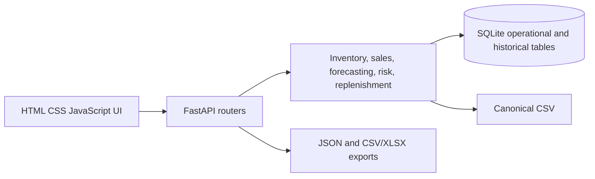

# SiteStock Project Report

## Problem and objectives

Construction sites need a consistent way to record material receipts, consumption, balances, sales, and replenishment. SiteStock demonstrates a local, unit-aware inventory workflow with historical demand analysis and model comparison.

- Maintain a transaction-based ledger with idempotent writes and unit checks.
- Show balances, alerts, sales, purchasing, and exports.
- Compare forecasts against Naive baselines using chronological validation.
- Keep forecast guidance separate from recorded stock and cost evidence.
- Provide one explicit, explainable inventory risk calculation for dashboard and replenishment.

## Dataset and prices

The canonical CSV contains 8,940 rows across 60 site/material series, 149 weekly observations each, dated 2024-01-01 through 2026-11-02. It has 16 columns: 12 identifiers/measurements and two past-only demand/price level labels, plus lead time and WPI month fields. Original quantities and stock-flow values were preserved. Historical unit prices were rebased to dated, indicative Dehradun reference levels using documented product-unit conversions, site factors, and time adjustments. They are not audited purchases or supplier quotes. See `DATASET_CARD.md`, `DATASET_AUDIT.md`, and `PRICE_SOURCES.md`.

## Forecast methodology and results

The prediction target is weekly consumption for one site/material pair. Candidates are Naive, Seasonal Naive, Multiple Linear Regression, Random Forest, and XGBoost when installed. Lag 1–4 and trailing four-period mean/standard deviation use only past observations. Each pair has three expanding-window rolling origins before a 20% final chronological holdout. Model selection uses mean rolling MAE; learned models are retained only if they beat Naive.

The completed evaluation covers all 60 pairs and 300 model artifacts. Naive was selected in 39 pairs. Mean per-series holdout scores for the selected models were MAE 65.733, RMSE 74.040, WAPE 34.046%, and MASE 0.150. Mean empirical coverage of selected-model nominal 90% intervals was 94.94%; coverage is diagnostic and does not guarantee future results. Full results are in `MODEL_RESULTS.md` and `model_metrics.json`.

## Inventory risk and replenishment

`inventory_app/risk.py` supplies the shared risk level, coverage, reorder point, overstock flag, order quantity, and suggestion. Lead-time demand is weekly forecast × lead weeks; safety stock is z(service level) × forecast-error sigma × √lead weeks. The interface offers 90%, 95%, and 98% service targets. Risk precedence is High → Medium → Low; missing stock/count or invalid inputs show High and withhold a numeric order. Eligible incoming stock, order-up-to gap, EOQ, minimum order, pack rounding, and maximum-stock conflict are handled in the API. The dashboard uses the same risk helper with a lightweight past-only four-week Naive baseline.

## Policy simulation

A retrospective replay compared selected-model, Naive, and fixed-reorder-point policies over the same 30-week holdout for 60 series. At 20% annual holding cost and a 2× shortage penalty, selected-model mean simulated total cost was ₹588,380 per series, compared with ₹656,508 for Naive and ₹634,388 for fixed reorder point. The fixed rule had slightly higher fill rate (92.83% vs 92.59%) and fewer stockout weeks (4.22 vs 4.87) than selected-model policy in that scenario. Cost rates and reference prices are assumptions; these are not observed savings. Full sensitivity details are in `POLICY_SIMULATION.md` and the per-series outputs.

## Architecture

The operational inventory ledger is separate from historical dataset observations. Only explicit transactions determine current stock; reference prices do not replace recorded cost layers.

## Limitations and conclusion

The series are synthetic scenario data with limited history. Verified suppliers, project progress, external drivers, carrying rates, and shortage penalties are not available. Forecast errors on this dataset do not establish field performance. The policy replay depends on explicit cost and price assumptions. Numeric replenishment guidance is withheld when source data are stale or live stock is unknown.

SiteStock demonstrates a working inventory architecture, time-aware forecast comparison, and transparent risk calculation. It supports education and demonstration; it is not evidence for real purchasing without verified local inputs and operational validation.
